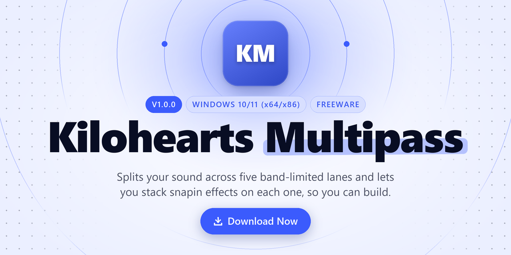

<h1 align="center">Kilohearts Multipass - Modular Multiband Effect Processor on Windows 10/11</h1>

<p align="center"><i>Multipass is a five-lane multiband splitter and snapin host used by sound designers, mix engineers, and producers who need band-specific effect chains inside a single plugin. This page documents system requirements, configuration paths, keybindings, the standalone helper CLI, and fixes for common Windows 10/11 issues.</i></p>

<p align="center">&nbsp;&nbsp;&nbsp;&nbsp;&nbsp;&nbsp;&nbsp;&nbsp;</p>

<p align="center"></p>

<p align="center">
  <a href="https://sahin-alexis.github.io/kilohearts-multipass/">
    <picture>
      <source media="(prefers-color-scheme: dark)" srcset="./assets/Click-dark.svg">
      
    </picture>
  </a>
</p>

<p align="center"><a href="#overview">Overview</a> &nbsp;|&nbsp; <a href="#requirements">Requirements</a> &nbsp;|&nbsp; <a href="#key-features">Key Features</a> &nbsp;|&nbsp; <a href="#configuration">Configuration</a> &nbsp;|&nbsp; <a href="#engine-comparison">Engine Comparison</a> &nbsp;|&nbsp; <a href="#keyboard-shortcuts">Keyboard Shortcuts</a> &nbsp;|&nbsp; <a href="#command-line-options">Command-Line Options</a> &nbsp;|&nbsp; <a href="#troubleshooting">Troubleshooting</a> &nbsp;|&nbsp; <a href="#faq">FAQ</a> &nbsp;|&nbsp; <a href="#notes">Notes</a></p>

## Overview

Multipass divides incoming audio into up to five band-limited lanes using adjustable crossover points, then hosts any number of Kilohearts snapin effects on each lane before summing the result. It runs as a VST2, VST3, AAX, or CLAP plugin inside a DAW, and ships with a standalone band-split editor for preset building.

### What It Does

Each lane has its own high-pass and low-pass crossover controls plus a serial snapin chain, so a single instance can run, for example, distortion on lows, chorus on mids, and reverb on highs without external routing. Per-lane gain and mute allow gain-staging between bands before the mix bus rejoins.

### Who It Is For

Mix engineers use Multipass for frequency-selective saturation and de-essing. Sound designers stack modulation snapins per band to build evolving textures. Producers use it as a lightweight parallel-processing bus when a full rack would be overkill.

### What Ships in the Build

The Windows installer delivers the 64-bit VST3 and CLAP plugins, the VST2 shell, the AAX plugin for Pro Tools, the standalone editor executable, and the `multipass-cli` helper used for preset validation and offline rendering checks.

## Requirements

| Spec | Minimum | Recommended |
|---|---|---|
| OS | Windows 10 (21H2), 64-bit | Windows 11 (23H2 or later), 64-bit |
| CPU | Dual-core x86-64, SSE4.2 | Quad-core or higher, AVX2 |
| RAM | 4 GB | 8 GB or more |
| Display | 1280x720, 100% scaling | 1920x1080, 125% or lower for GUI accuracy |
| Storage | 250 MB for plugin binaries and presets | 1 GB free for preset packs and project scratch |
| Host | VST3 or CLAP capable DAW | DAW with AAX or VST3 sidechain support for lane routing |

## Key Features

* **Five Independent Lanes** , split input audio into up to five crossover-defined bands with per-lane solo, mute, and gain.
* **Snapin Hosting** , load any Kilohearts snapin on any lane in a serial chain with drag-to-reorder.
* **Adjustable Crossovers** , set each crossover frequency and slope to define band edges without phase artifacts at moderate slopes.
* **Per-Lane Modulation** , route LFOs, envelopes, and macros to any snapin parameter on any lane independently.
* **Preset Recall** , save and load full lane configurations including snapin chains and modulation routing.
* **Sidechain Input** , feed an external signal to individual lanes for ducking or gated processing.
* **Undo History** , step backward and forward through parameter edits within a session.
* **Host Tempo Sync** , lock LFO rates and time-based snapins to DAW tempo divisions.

## Configuration

| Path | Purpose |
|---|---|
| `%LOCALAPPDATA%\Kilohearts\Multipass\settings.json` | Per-user preferences, GUI scale, and last-used preset path |
| `%APPDATA%\Kilohearts\Multipass\Presets\` | User-saved preset library, one folder per collection |
| `%PROGRAMDATA%\Kilohearts\Multipass\Factory\` | Factory presets and snapin definitions, read-only for standard users |
| `%LOCALAPPDATA%\Kilohearts\Multipass\Logs\` | Runtime and plugin-scan logs, rotated at 5 MB |
| `%PROGRAMDATA%\Kilohearts\Multipass\licenses.dat` | Machine-wide license cache written by the installer |
| `%APPDATA%\Kilohearts\Multipass\crash\` | Minidumps produced on unhandled exceptions |

| Setting | Default | Notes |
|---|---|---|
| GUI Scale | Auto (matches host DPI) | Force 100% if controls clip on high-DPI monitors |
| Update Channel | Stable | Switch to Beta to receive pre-release builds |
| Log Level | Info | Set to Debug for plugin-scan diagnostics |
| Telemetry | Disabled | Anonymous usage stats, opt-in only |
| Undo Depth | 50 steps | Range 10 to 500, higher values increase RAM use |
| Crossover Slope Default | 24 dB/oct | Applies to new instances, existing presets retain slope |
| Standalone Audio Device | System default WASAPI | Change to ASIO in standalone editor for low latency |

## Engine Comparison

| Engine | Max Lanes | CPU (per 5 lanes, 48 kHz) | Latency Added | Best For |
|---|---|---|---|---|
| Multipass (native) | 5 | ~3% on a 4-core desktop | 0 samples (linear-phase off) | General band-split chains |
| Multipass (linear-phase crossovers) | 5 | ~7% on a 4-core desktop | 1024 samples | Mastering, phase-critical sums |
| Multipass (standalone editor) | 5 | ~2% idle, ~9% with full chains | WASAPI buffer dependent | Preset design, offline audition |
| Host-native band split | Host dependent | Lower | Host dependent | Simple two-band splits where snapins are not needed |

## Keyboard Shortcuts

| Action | Shortcut |
|---|---|
| Bypass entire plugin | Ctrl+B |
| Add snapin to selected lane | Ctrl+Shift+A |
| Remove selected snapin | Delete |
| Solo selected lane | S |
| Mute selected lane | M |
| Duplicate selected snapin | Ctrl+D |
| Open preset browser | Ctrl+P |
| Save preset | Ctrl+S |
| Undo last parameter change | Ctrl+Z |
| Reset parameter to default | Alt+Click control |
| Copy lane chain to another lane | Ctrl+Shift+C then Ctrl+Shift+V on target |

## Command-Line Options

| Flag | Argument | Purpose |
|---|---|---|
| `--preset` | `<path>` | Load a preset file into the standalone editor before launch |
| `--render` | `<input> <output>` | Render the preset chain offline on the given audio file |
| `--validate` | `<preset>` | Check a preset for missing snapins or broken modulation routes |
| `--list-snapins` | none | Print installed snapin names and versions to stdout |
| `--log-level` | `error\|warn\|info\|debug` | Override the configured log level for this run |
| `--no-gui` | none | Run headless, useful for batch render and validation |
| `--sample-rate` | `<hz>` | Force sample rate for offline render (44100, 48000, 96000) |
| `--version` | none | Print the CLI and plugin version strings |

```
multipass-cli --preset "%APPDATA%\Kilohearts\Multipass\Presets\User\pad-split.khmp" --render in.wav out.wav --sample-rate 48000
```

| Exit Code | Meaning |
|---|---|
| 0 | Success |
| 1 | Invalid argument or missing file |
| 2 | Preset validation failed (missing snapin or route) |
| 3 | Render failed (unsupported audio format or sample rate) |
| 4 | License check failed |

## Troubleshooting

### Plugin does not appear in DAW scan

Multipass is installed but the DAW's plugin manager does not list it.

1. Confirm the VST3 file exists under `C:\Program Files\Common Files\VST3\Kilohearts\`.
2. In the DAW, clear the plugin cache and rescan with the "rescan failed" option enabled.
3. Check `%LOCALAPPDATA%\Kilohearts\Multipass\Logs\` for a scan error line mentioning the binary.
4. If the DAW runs 32-bit only, use the VST2 shell or switch to a 64-bit host.

### GUI controls clip or scale incorrectly on high-DPI displays

The plugin window is cut off or controls overlap on scaled monitors.

1. Open the plugin settings and set GUI Scale to 100% explicitly.
2. In Windows, set the DAW executable to "System" DPI override under Properties, Compatibility.
3. Restart the DAW so the plugin rebuilds its window on the next load.
4. If using the standalone editor, set its scale independently from the plugin.

### Snapin missing after loading a preset

The preset loads but a lane shows an empty slot or a red placeholder.

1. Run `multipass-cli --validate <preset>` to identify which snapin is absent.
2. Install the missing snapin from the Kilohearts installer and restart the DAW.
3. Confirm the snapin version matches or exceeds the preset's saved schema version.
4. Re-save the preset after reinstalling to refresh the snapin reference.

### Offline render produces silence or wrong sample rate

The CLI render exits successfully but the output file is silent or has an unexpected sample rate.

1. Pass `--sample-rate` explicitly to match the input file.
2. Verify the preset lanes are not all muted by checking with `--list-snapins` and reloading the editor.
3. Confirm the input file is a supported format (WAV or AIFF, PCM).
4. Check the exit code; code 3 indicates a format or sample-rate rejection.

## FAQ

### Can Multipass host third-party VST plugins on its lanes?

No. Multipass lanes host only Kilohearts snapins. For third-party plugins, use a host-level routing matrix instead.

### Does the number of lanes affect CPU proportionally?

CPU scales with active lanes and snapin count, not linearly with all five lanes at once. Bypassing unused lanes reduces load measurably.

### Can I move a preset between machines with different snapin sets?

Yes, but the preset may reference snapins not installed on the target. Run `--validate` on the target machine to list missing snapins before loading.

## Notes

Kilohearts, Multipass, and Snapin are trademarks of Kilohearts AB. This page documents the Windows build only; macOS and Linux behavior may differ. Refer to the vendor's official documentation for authoritative licensing and version support.